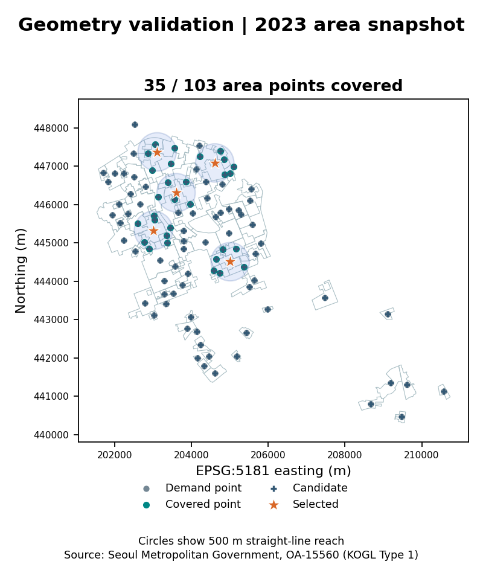

# 서울 편의점 상권 매출 예측 및 출점 후보 최적화

## 분석 질문

매출 예측 상위 5곳을 고르는 전략과, 매출 잠재력을 유지하면서 더 넓은 수요권을 확보하는 전략은 어떻게 다른가?

## 데이터

- **자료 기준일** `2024-04-30` (한국시간)
- **기본 분석 기간** 서울 상권의 2021년 1분기~2022년 4분기. 이 기간의 매출·점포 ZIP을 확보했으며, 파일 버전의 기준일 적격성을 확인하지 못해 매출 검증은 미실행 상태다.
- **실제 공간 검증 입력** 서울시 영역-상권 2023-10-23 버전, 서울 25개 자치구. 2022년 테스트 이후의 공간 정보이므로 별도 시나리오에 사용했다.
- 데이터 파일별 다운로드 URL, 수정일 근거, 이용 조건, 해시는 [데이터 출처](docs/data_sources.md)에 있다.

## 방법

1. 업종명 `편의점`과 코드 `CS300002`의 일치를 확인한다. 분기·상권·업종 키를 검사하고 상권별로 같은 분기의 추정매출을 일반·프랜차이즈를 포함한 편의점 수로 나눈다. 매출 누락과 점포 수 0 또는 누락은 타깃 평가에서 제외한다.
2. 목표 분기 시작을 기준으로 `t-2`까지의 매출·점포·개폐업·프랜차이즈 정보와 그때 이용 가능했다고 가정한 라벨을 쓴다. 2022년 1·2분기 순차 검증의 분기별 MAE 평균으로 기준선, Ridge, 랜덤 포리스트 중 하나를 고정한 후 2022년 4분기를 테스트한다. WAPE와 Spearman, 과거 매출 제외 실험도 함께 산출한다.
3. 영역 대표점 중 예측이 결합되는 비율이 가장 높은 자치구를 선택한다. 최소 10개 후보가 있는 자치구를 비교하며 동률은 후보 수와 자치구 코드로 해소한다. 같은 후보·수요 지점·거리로 A(매출 순위), B(가중 MCLP), C(B 최대 커버리지의 95% 이상에서 예측 지표 합 최대화)를 비교한다. 기본 조건은 5곳·500m다. 거리 300·500·700m, 선정 3·5·10곳, C 하한 90·95·100%를 교차한다.
4. 수요 가중치는 과거 길단위인구, 편의점 외 업종 거래건수, 균등 가중치 순으로 검토한다. 한 수요점에 원이 겹쳐도 한 번만 합산한다. 최종 후보는 현장 조사 우선순위이며, 예측 지표는 기존 상권의 편의점당 추정매출 수준이다. 신규점의 실제 매출에는 별도의 점포·입지·운영 자료가 필요하다.

## 검증 결과

| 항목 | 실제 실행 결과 |
| --- | --- |
| 기준선·Ridge·랜덤 포리스트 | **미실행.** 포털 파일 목록의 매출·점포 수정일은 2023-10-30이나, 다운로드 ZIP 4개의 내부 CSV 날짜는 2025-06-04다. 기준일 이전 파일과의 동일성을 확인하지 못했다. |
| 출점 전략 A·B·C 비교 | **미실행.** 적격 매출 예측값 확보 후 같은 후보 집합에서 비교한다. |
| 영역 파일 | 서울 25개 자치구, 상권 대표점 1,650개, 중복 상권 코드 0개, 동일 좌표 중복 0개, 좌표계 EPSG:5181. |
| 공간 계산 점검 | 영역 개수가 가장 많은 강남구의 대표점 103개를 균등 가중치로 사용했다. 5곳·500m MCLP에서 35개 지점(34.0%)이 포함됐다. |



위 지도는 2023년 영역 파일의 **공간 계산 검증용**이다. 자치구 선택에는 영역 개수를 사용했다. 모델을 실행할 수 있게 되면 예측 결합률로 자치구를 선택하고 실제 A·B·C 후보 지도를 별도로 생성한다. 길단위인구 적용과 2023년 관측치 확장도 미실행이다. [결과 요약](results/summary.md) · [데이터 품질 보고서](docs/data_quality.md)

## 실행 방법

Windows PowerShell에서 Python 3.11로 실행한다.

```powershell
py -3.11 -m venv .venv
.venv/Scripts/python.exe -m pip install -r requirements.txt
.venv/Scripts/python.exe -m seoul_location --download
.venv/Scripts/python.exe -m unittest discover -s tests -v
```

기본 명령은 현재 포털 ZIP을 `data/raw/`에 확보하고 적격한 단계만 실행한다. 자동 수집에 실패하면 [수동 다운로드 경로](docs/data_sources.md#수동-다운로드와-보관본-사용)를 따른다. 기준일 적격 보관본이 확보되면 별도 매니페스트로 전체 실행을 요구할 수 있다.

```powershell
.venv/Scripts/python.exe -m seoul_location --manifest data/archive_inputs.json --out data/archive_results --require-full
```

- **생성됨** `results/data_quality.json`, `results/run_status.json`, `results/area_validation.png`. 실행 결과를 해석한 문서는 `results/summary.md`다.
- **전체 실행 시 생성** `model_comparison.csv`, `predictions.csv`, `district_join_rates.csv`, `strategy_summary.csv`, `strategy_candidates.csv`, `selection_frequency.csv`, `candidate_map.png`. `--require-full`은 예측 또는 A·B·C 비교가 미실행이면 종료 코드 2를 반환한다.
