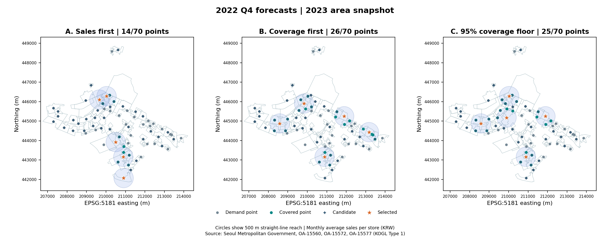

# 서울 편의점 입지 분석

서울시 상권 데이터를 활용해 편의점 매출 수준을 예측하고, 매출이 높은 상권을 고르는 전략과 더 넓은 범위를 확보하는 전략을 비교했다. 두 기준을 함께 고려해 현장 조사 우선순위를 정하는 것이 목적이다.

**관련 수상** · 2024년 한국경영컨설팅학회 경진대회 대상  
*1인 가구 증가에 따른 편의점 입지 선정 및 포지셔닝 전략 제안*

## 분석 방법

1. **매출 지표 산출** · 서울시의 2021~2022년 분기별 상권 추정매출과 점포 수를 결합해 상권별 편의점 한 곳의 월평균 추정매출을 계산했다. 저장소의 검증에는 후일 배포본에 포함된 2021~2022년 관측치를 사용했다. [데이터 출처와 버전](docs/data_sources.md)
2. **매출 예측** · 목표 분기보다 두 분기 전까지의 자료를 이용할 수 있다고 가정했다. 2022년 1·2분기로 모델을 비교한 뒤 4분기 공통 표본 715개 상권에서 평가했다. [모델별 검증 결과](results/model_comparison.csv)
3. **입지 선정** · 상권 경계와 결합률이 가장 높았던 송파구에서 후보 44곳 중 5곳을 골랐다. 후보에서 직선거리 500m 이내에 들어오는 상권 대표점 수로 커버리지를 비교했다.

## 핵심 결과

**매출 예측** · 두 분기 전 매출을 그대로 쓰는 기준선의 평균 절대 오차(MAE)는 월 1,680.3만 원/점포였다. 릿지 회귀(1,759.5만 원)와 랜덤 포리스트(1,863.6만 원)보다 낮았다. 상권 간 매출 순위 일치도는 릿지 회귀가 가장 높았다.

**입지 선정** · 절충안은 매출 우선 전략보다 대표점 11개를 더 커버했다. 커버리지 우선 전략과 비교하면 대표점 1개를 덜 커버하면서 예측 매출 지표 합은 20.7% 높았다.

| 전략 | 선택 기준 | 대표점 커버리지 | 예측 매출 지표 합 (억 원) |
| --- | --- | ---: | ---: |
| 매출 우선 | 예측 매출 상위 5개 상권 | 14/70 (20.0%) | 16.59 |
| 커버리지 우선 | 500m 내 대표점 수 최대화 | 26/70 (37.1%) | 8.17 |
| 절충안 | 최대 커버리지의 95% 이상에서 예측 매출 지표 합 최대화 | 25/70 (35.7%) | 9.87 |



예측 매출 지표 합은 선택한 상권의 **기존 편의점당 월평균 추정매출 예측값**을 더한 값이다. 커버리지는 각 대표점에 같은 가중치를 부여해 계산했다. 실제 출점 전에는 유동인구, 도보 접근성, 임대료 등 별도 현장 조사가 필요하다. [45개 입지 시나리오와 민감도 분석](results/summary.md) · [전략별 후보](results/strategy_candidates.csv)

## 실행 방법

저장소 루트에서 Python 3.11 가상환경을 활성화한 뒤 실행한다.

```bash
python -m pip install -r requirements.txt
python -m seoul_location --download --allow-revised-observations --require-full --out outputs/reproduction
```

코드는 입력 파일의 체크섬과 관측 분기를 확인하고, 결과를 지정한 출력 폴더에 저장한다. [수동 다운로드와 보관본 사용](docs/data_sources.md#수동-다운로드와-보관본-사용) · [데이터 품질 보고서](docs/data_quality.md)
