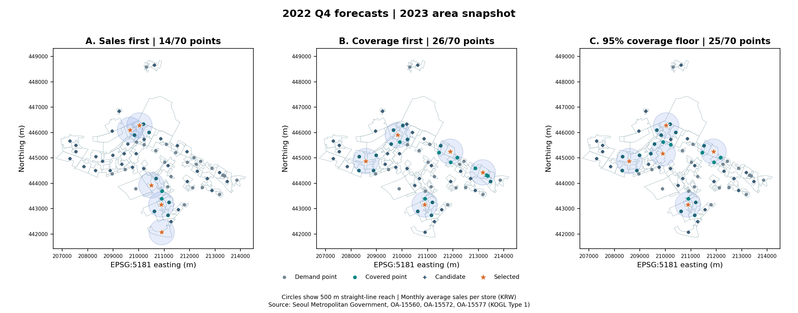

# 1인 가구 증가에 따른 편의점 입지 선정 및 포지셔닝 전략 제안(한국경영컨설팅대회 대상 2024)

## 분석 질문

매출 예측 상위 5곳을 고르는 전략과, 매출 잠재력을 유지하면서 더 넓은 수요권을 확보하는 전략은 어떻게 다른가?

## 데이터

- **자료 기준일** `2024-04-30`
- **관측 기간** 2021년 1분기~2022년 4분기. 서울시 추정매출·점포 ZIP 4개의 모든 행이 해당 연도의 관측치임을 확인했다. ZIP 내부 날짜는 2025-06-04이며, 사용자가 허용한 **후일 배포본의 과거 관측치**를 사용했다. 당시 배포본과의 동일성 및 분기별 실제 공개일은 확인되지 않았다.
- **공간 자료** 서울시 영역-상권 2023-10-23 버전. 2022년 매출 테스트와 분리된 공간 시나리오에 사용했다. 길단위인구와 2023년 관측치 확장은 미실행이다. [파일별 출처·SHA-256](docs/data_sources.md)

## 방법

1. 업종명 `편의점`과 코드 `CS300002`가 일치하는 행에서 분기 내 월평균 추정매출을 해당 분기의 일반·프랜차이즈 편의점 수 합으로 나눈다. 단위는 **원/월/점포**다.
2. `t−2`까지 이용 가능했다고 가정해 매출·점포·개폐업·프랜차이즈 정보를 구성한다. 2022년 1·2분기 순차 검증의 평균 MAE로 기준선·Ridge·랜덤 포리스트 중 하나를 고정하고, 2022년 4분기에서 같은 평가 표본으로 비교한다.
3. 영역 결합률이 가장 높은 송파구를 선택했다. A는 예측 상위 5곳, B는 500m MCLP 커버리지 최대, C는 B 최대 커버리지의 95% 이상에서 예측 지표 합 최대다. 세 전략은 같은 44개 후보와 70개 수요 지점을 사용한다.

## 검증 결과

**서울 2022년 4분기 공통 표본 715개**에서 `t−2` 기준선이 가장 낮은 MAE와 WAPE를 기록했다. Ridge의 Spearman이 가장 높았다.

| 모델 | MAE (만 원/월/점포) | WAPE | Spearman |
| --- | ---: | ---: | ---: |
| **t−2 기준선** | **1,680.3** | **12.67%** | 0.9582 |
| Ridge | 1,759.5 | 13.27% | **0.9603** |
| 랜덤 포리스트 | 1,863.6 | 14.06% | 0.9583 |

**송파구 5곳·500m**에서 절충안 C는 A보다 상권 대표점 **11개를 더** 커버했다. C의 예측 매출 지표 합은 A의 **59.5%**였고, 커버리지 우선 B보다 **20.7%** 높았다. C는 B의 최대 커버리지 26개 중 25개를 확보했다.

| 전략 | 균등 가중 상권 대표점 커버리지 | 예측 지표 합 (억 원/월/점포 지표의 합) |
| --- | ---: | ---: |
| A. 매출 우선 | 14/70 (20.0%) | 16.59 |
| B. 커버리지 우선 | 26/70 (37.1%) | 8.17 |
| C. 절충안 | 25/70 (35.7%) | 9.87 |



가중치는 대표점마다 동일하다. 선택 상권은 **현장 조사 우선순위**이며, 예측 지표는 기존 상권의 편의점당 추정매출 수준이다. 커버리지 백분율의 분모는 상권 대표점 수이고, 예측 지표 합은 신규점 매출이나 유동인구 규모를 나타내지 않는다. [45개 시나리오와 민감도 요약](results/summary.md) · [데이터 품질 보고서](docs/data_quality.md)

## 실행 방법

Windows PowerShell에서 Python 3.11로 실행한다.

```powershell
py -3.11 -m venv .venv
.venv/Scripts/python.exe -m pip install -r requirements.txt
.venv/Scripts/python.exe -m seoul_location --download --allow-revised-observations --require-full
.venv/Scripts/python.exe -m unittest discover -s tests -v
```

`--allow-revised-observations`는 매출·점포 2021·2022년 파일에만 적용한다. SHA-256, 관측 연도, 연도별 4개 분기, 업종과 결합 키는 모두 검사한다. [수동 다운로드 및 당시 보관본 사용](docs/data_sources.md#수동-다운로드와-보관본-사용)

- **예측** [모델 비교표](results/model_comparison.csv) · [상권별 예측](results/predictions.csv)
- **입지** [자치구별 결합률](results/district_join_rates.csv) · [전략 비교표](results/strategy_summary.csv) · [선택 상권](results/strategy_candidates.csv) · [반복 선정 횟수](results/selection_frequency.csv) · [후보 지도](results/candidate_map.png)
- **검증** [품질 JSON](results/data_quality.json) · [실행 상태](results/run_status.json) · [영역 좌표 검증 지도](results/area_validation.png)
